<div align="center">


<h3>Teaching Vision-Language-Action Models the Contact Dynamics Beyond Vision and Action</h3>

<p>
  <a href="#citation"></a>
  <a href="https://tacinno.github.io"></a>
  <a href="docs/en/model_zoo.md"></a>
  
  
  <a href="LICENSE"></a>
</p>

<p>
  <a href="#highlights">Highlights</a> ·
  <a href="#method">Method</a> ·
  <a href="#results">Results</a> ·
  <a href="#getting-started">Getting started</a> ·
  <a href="docs/en/model_zoo.md">Model zoo</a> ·
  <a href="#citation">Citation</a>
</p>

</div>

**TacInno** teaches a vision-language-action (VLA) policy the part of tactile sensing that its cameras and its own
actions cannot explain, the *tactile innovation*, and uses it **only as a training target**. A tokenizer conditioned
on visual observations and executed actions compresses the future tactile change into a 16-bit code, and the policy,
**TacInno-VLA**, learns to predict the code. Nothing is added for the code at deployment.

<p align="center"></p>

## Highlights

<table align="center">
  <tr>
    <td align="center" width="33%"><h2>87.5%</h2>average success on <b>six UniVTAC tasks</b><br><sub>+10.7 points over the strongest visuo-tactile baseline</sub></td>
    <td align="center" width="33%"><h2>70.5%</h2>average success on <b>four real-world tasks</b><br><sub>+9.0 points over the strongest visuo-tactile baseline</sub></td>
    <td align="center" width="33%"><h2>88% &rarr; 0%</h2>on Lift Can when the tactile input is removed at test time<br><sub>the actions depend on tactile input</sub></td>
  </tr>
</table>

- **What tactile input adds.** Much of the tactile change, such as the gel deformation during gripper closure, is
  predictable from images and executed actions. TacInno isolates the remainder, the contact response that only
  tactile input reveals, such as incipient slip and jamming during insertion.
- **A target, not an input.** The code supervises the tactile tokens of the policy through four code queries that no
  other token attends to, so the code loss shapes what the action expert keeps from tactile input.
- **No tactile pretraining.** TacInno-VLA is fine-tuned from $\pi_{0.5}$ on 50 demonstrations per task.

### TacInno-VLA in simulation (UniVTAC)

<table>
  <tr>
    <td>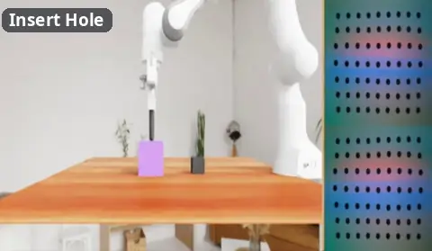</td>
    <td>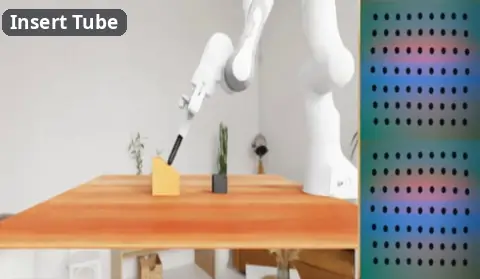</td>
  </tr>
  <tr>
    <td>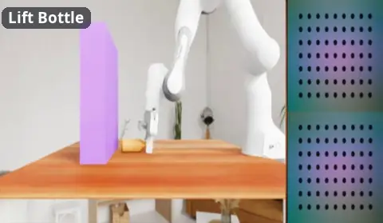</td>
    <td>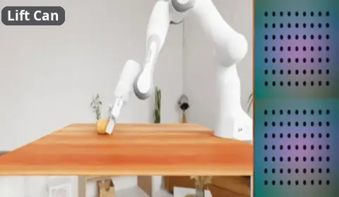</td>
  </tr>
  <tr>
    <td>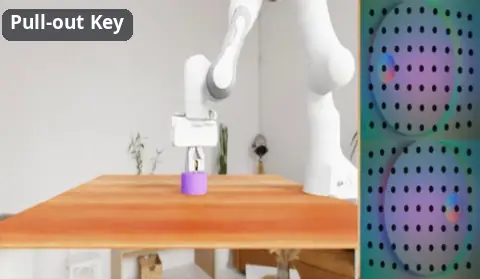</td>
    <td>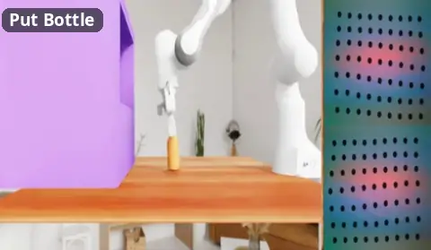</td>
  </tr>
</table>
<p align="center"><sub>Closed-loop rollouts from the evaluation seeds. Left of each clip: head camera. Right: the two tactile sensors.</sub></p>

### TacInno-VLA in the real world

<table>
  <tr>
    <td>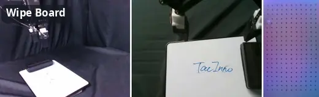</td>
    <td>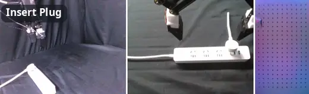</td>
  </tr>
  <tr>
    <td>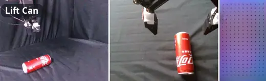</td>
    <td>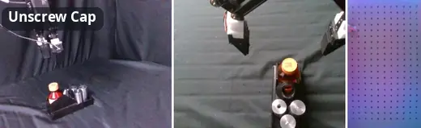</td>
  </tr>
</table>
<p align="center"><sub>Franka FR3 with a Xense vision-based tactile sensor. Third-person camera, wrist camera and tactile image, sped up.</sub></p>

### Does the policy use tactile input?

<p align="center">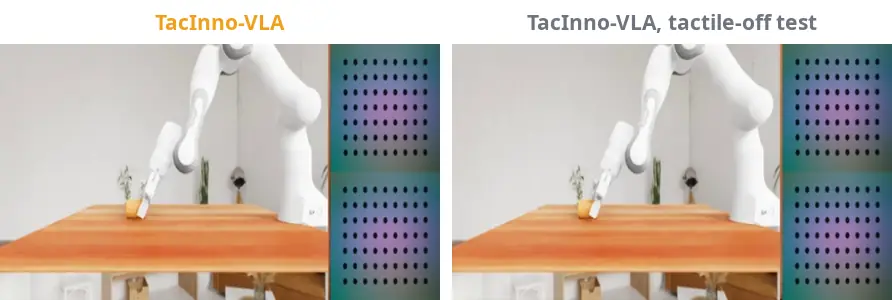</p>
<p align="center"><sub>Same seed, same policy. With a fixed no-contact tactile frame (right), TacInno-VLA reaches the can but fails to lift it.</sub></p>

## Method

TacInno works in three steps.

1. **Define tactile innovation.** The future tactile change splits into a component predictable from the visual
   observations and the executed actions, and a residual that the two cannot explain.
2. **Isolate it with the TacInno tokenizer.** An encoder and a decoder, both spatial-temporal Transformers conditioned
   on DINOv2 image features and executed actions, compress the tactile observations from $t$ to $t{+}15$ into a code
   of four tokens with 16 values each. Since the decoder already receives the images and actions, the code only needs
   to carry what they cannot explain.
3. **Teach the policy to predict it.** TacInno-VLA inserts proprioceptive tokens, 60 tactile tokens and four code
   queries into the action expert of $\pi_{0.5}$. A per-token classifier predicts the code from the code queries, and a
   contact-state head predicts contact properties from the tactile tokens. The tokenizer and both heads are removed at
   deployment.

<p align="center">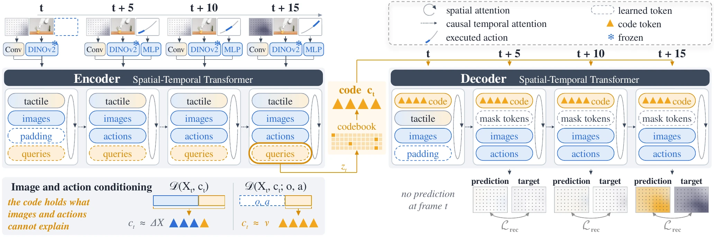</p>
<p align="center"><sub><b>TacInno tokenizer.</b> The code retains the tactile change that visual observations and executed actions cannot explain.</sub></p>

<details>
<summary><b>TacInno-VLA architecture</b></summary>
<p align="center">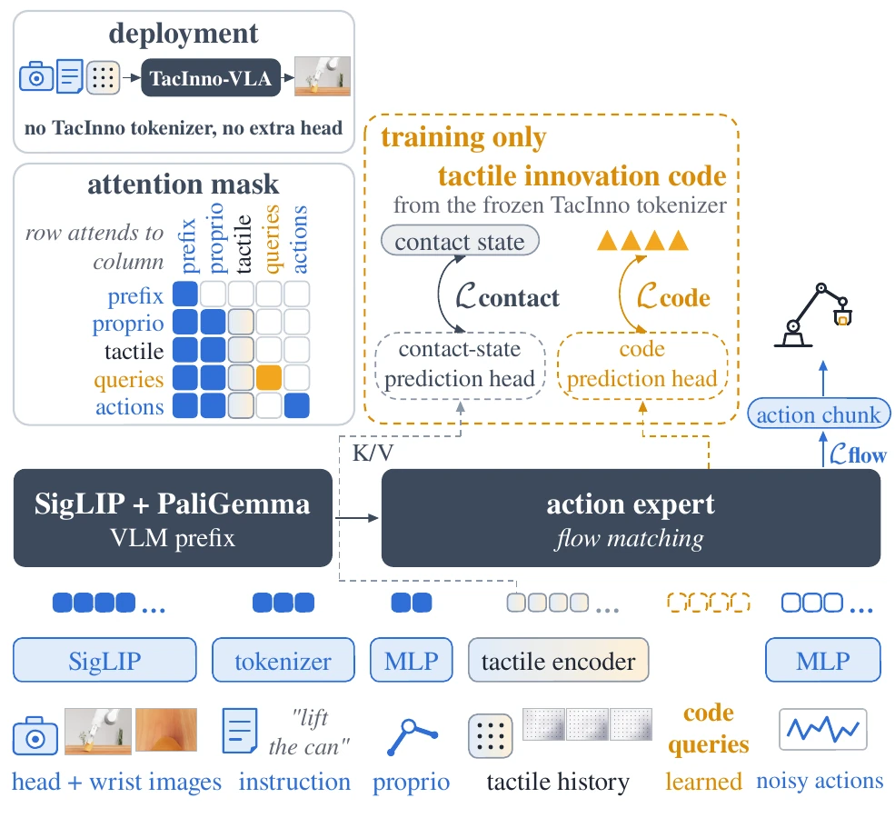</p>
<p align="center"><sub>Tactile tokens and four learnable code queries are inserted into the action expert of π<sub>0.5</sub>. The attention mask prevents all other tokens from attending to the code queries.</sub></p>
</details>

<details>
<summary><b>When does tactile innovation occur?</b></summary>
<p align="center">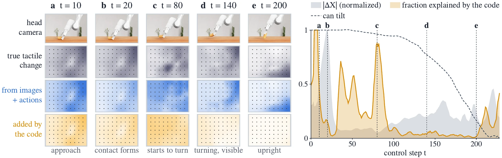</p>
<p align="center"><sub>On a held-out Lift Can demonstration, the fraction explained by the code peaks before contact onset and at incipient slip.</sub></p>
</details>

## Results

### Simulation: six UniVTAC tasks

All policies are trained on the same 50 demonstrations per task and evaluated on the same 100 seeds per task.
Success rates (%).

| Method | Tactile | Insert Hole | Insert Tube | Lift Bottle | Lift Can | Pull-out Key | Put Bottle | Avg. |
|:--|:--|:-:|:-:|:-:|:-:|:-:|:-:|:-:|
| UniVTAC-ACT | input | 46 | 55 | 49 | 27 | 41 | 25 | 40.5 |
| π<sub>0.5</sub> | none | 88 | 70 | 26 | 25 | 36 | 40 | 47.5 |
| FTP-π<sub>0.5</sub> | input | 77 | **99** | 45 | 33 | 19 | **88** | 60.2 |
| FTP-1 | input | 63 | **99** | 61 | **94** | 40 | **88** | 74.2 |
| 𝒩<sub>0</sub>-VTLA | input | **99** | 90 | 24 | 81 | <u>77</u> | <u>81</u> | 75.3 |
| SimpleTouch | input + predict | 94 | 93 | **82** | 65 | 54 | 73 | <u>76.8</u> |
| **TacInno-VLA (ours)** | input + innovation target | <u>95</u> | <u>95</u> | <u>78</u> | <u>88</u> | **94** | 75 | **87.5** |

### Real world: four contact-rich tasks

| Policy | Wipe Board | Insert Plug | Lift Can | Unscrew Cap | Avg. |
|:--|:-:|:-:|:-:|:-:|:-:|
| FTP-1 | **88** | 16 | 66 | 64 | 58.5 |
| SimpleTouch | 82 | 28 | 62 | 74 | 61.5 |
| TacInno-VLA, tactile-off | 52 | 10 | 46 | 52 | 40.0 |
| w/o code loss | 62 | 22 | 50 | 56 | 47.5 |
| w/o tactile input | 62 | 14 | 52 | 78 | 51.5 |
| **TacInno-VLA (ours)** | **88** | **38** | **74** | **82** | **70.5** |

<details>
<summary><b>Ablation study on the two lifting tasks</b></summary>

| Variant | Lift Can | Lift Bottle | Avg. |
|:--|:-:|:-:|:-:|
| **TacInno-VLA** | **88** | **78** | **83.0** |
| w/o conditioning | 63 | 61 | 62.0 |
| vision-only conditioning | 62 | 77 | 69.5 |
| two-frame code | 81 | 72 | 76.5 |
| w/o attention mask | 66 | 70 | 68.0 |
| w/o code loss | 84 | 68 | 76.0 |
| w/o tactile input | 25 | 26 | 25.5 |

</details>

<details>
<summary><b>Tactile-off test</b> (relative change when the tactile input is replaced by a fixed no-contact frame)</summary>

| Policy | Closed-loop success drop, Lift Can | Closed-loop success drop, Lift Bottle | Open-loop arm action change, Lift Can | Open-loop gripper action change, Lift Can |
|:--|:-:|:-:|:-:|:-:|
| 𝒩<sub>0</sub>-VTLA | 5% | 8% | −6% | +4% |
| FTP-1 | 15% | −27% | −1% | +45% |
| SimpleTouch | 15% | 5% | +5% | +84% |
| UniVTAC-ACT | 17% | 58% | +9% | +50% |
| **TacInno-VLA (ours)** | **100%** | **95%** | **+156%** | **+238%** |

Closed-loop drops are computed on the same seeds with and without tactile input (100 seeds on Lift Can and 25 on Lift
Bottle, except 25 on both tasks for UniVTAC-ACT and 100 on both for 𝒩<sub>0</sub>-VTLA). Open-loop changes are the
relative change of the error of the predicted actions on held-out Lift Can demonstrations.

</details>

## Getting started

| Step | Guide |
|:--|:--|
| Install the environment | [docs/en/get_started.md](docs/en/get_started.md) |
| Prepare UniVTAC demonstrations, tactile observations and code targets | [docs/en/data_preparation.md](docs/en/data_preparation.md) |
| Train the TacInno tokenizer and export codes | [docs/en/tokenizer.md](docs/en/tokenizer.md) |
| Train TacInno-VLA | [docs/en/policy.md](docs/en/policy.md) |
| Evaluate in UniVTAC (closed loop, tactile-off test) | [docs/en/evaluation.md](docs/en/evaluation.md) |
| Deploy on a real robot | [docs/en/real_robot.md](docs/en/real_robot.md) |
| Download checkpoints | [docs/en/model_zoo.md](docs/en/model_zoo.md) |

A closed-loop evaluation of a released checkpoint takes two shells:

```bash
# shell 1, GPU machine: serve TacInno-VLA for one task
python tools/serve_policy.py checkpoints/sim/lift_can --task lift_can:8000 --bind 0.0.0.0

# shell 2, UniVTAC environment: install the client once, then evaluate 100 seeds with twice the default action limit
python tools/eval_univtac.py install --univtac-root /path/to/UniVTAC
python tools/eval_univtac.py run --univtac-root /path/to/UniVTAC --task lift_can --host <server> --port 8000
python tools/eval_univtac.py summarize /path/to/UniVTAC/eval_result/TacInnoVLA/lift_can/deploy_lift_can
```

## Repository structure

The code follows the conventions of MMDetection: Python configs with `_base_` inheritance, registries for every
component, and command-line tools that take a config.

```
TacInno/
├── configs/
│   ├── _base_/            # datasets, models and schedules shared by the configs below
│   ├── tokenizer/         # TacInno tokenizer
│   ├── tacinno_vla/       # TacInno-VLA, one config per UniVTAC task
│   └── real_robot/        # TacInno-VLA for the real-world tasks
├── tacinno/
│   ├── config.py          # Config.fromfile with _base_ inheritance
│   ├── registry.py        # DATASETS, TRANSFORMS, MODELS, LOSSES, HOOKS
│   ├── datasets/          # demonstrations, tactile observations, code targets
│   ├── models/
│   │   ├── tokenizer/     # encoder, per-token vector quantization, decoder
│   │   └── policy/        # tactile branch, code queries, auxiliary heads on π0.5
│   ├── engine/            # training loop, EMA, checkpointing and resume
│   ├── apis/              # inference and the policy server
│   └── evaluation/        # UniVTAC client, success rates, McNemar test
├── tools/                 # train_tokenizer.py, export_codes.py, train_policy.py, serve_policy.py, eval_univtac.py, ...
├── third_party/openpi/    # π0.5 in PyTorch (Apache 2.0)
├── tests/
└── docs/en/
```

## Model zoo

| Model | Data | Checkpoint |
|:--|:--|:--|
| TacInno tokenizer (simulation) | six UniVTAC tasks, demonstrations 0 to 89 | coming soon |
| TacInno-VLA, one per UniVTAC task | 50 demonstrations per task | coming soon |
| TacInno tokenizer and TacInno-VLA (real world) | 45 demonstrations per task, four tasks | coming soon |

Details, per-task settings and the tokenizer variants of the ablation study are in [docs/en/model_zoo.md](docs/en/model_zoo.md).

## Citation

```bibtex
@article{li2026tacinno,
  title   = {TacInno: Teaching Vision-Language-Action Models the Contact Dynamics Beyond Vision and Action},
  author  = {Li, Weile and Lou, Yunfan and Shi, Muqing and Zhang, Zihao and Huang, Zhenbiao and Yao, Boxian and Zhu, Xiyu and Pang, Zhibo},
  journal = {arXiv preprint},
  year    = {2026}
}
```

## Acknowledgements

TacInno-VLA builds on [openpi](https://github.com/Physical-Intelligence/openpi) and the $\pi_{0.5}$ model, and its
training code starts from the openpi-based code of [FTP-1](https://arxiv.org/abs/2606.13102) (Foundation Tactile
Policy). Simulation experiments use the [UniVTAC](https://github.com/univtac/UniVTAC) benchmark and its evaluator, and the tokenizer uses
[DINOv2](https://github.com/facebookresearch/dinov2) image features. We thank the authors for releasing their work.
See [NOTICE](NOTICE) for third-party licenses.

## License

The code is released under the [Apache 2.0 license](LICENSE). Code in `third_party/` keeps its original license. The
checkpoints are fine-tuned from $\pi_{0.5}$ and are subject to the licenses of the base model and its PaliGemma
components, including the Gemma Terms of Use.
