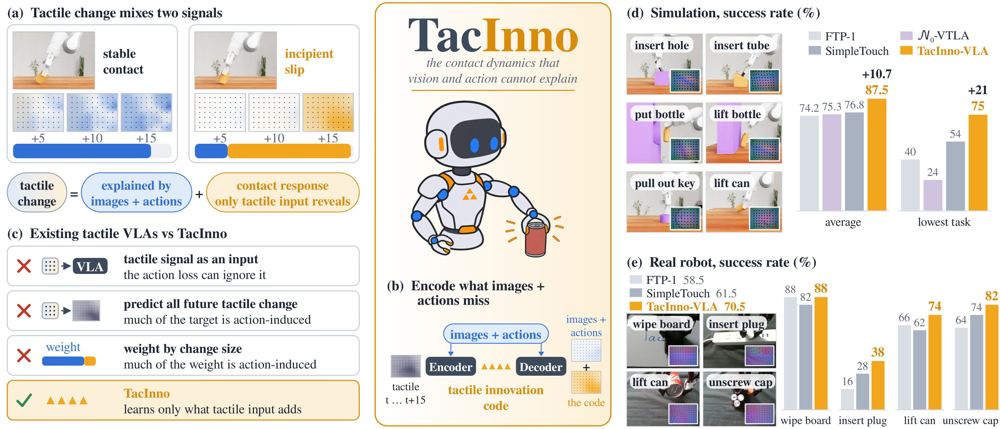

<div align="center">


<h3>Teaching Vision-Language-Action Models the Contact Dynamics Beyond Vision and Action</h3>

<p>
  <a href="https://tacinno.github.io"></a>
  <a href="#citation"></a>
  <a href="docs/en/model_zoo.md"></a>
  
  
  <a href="LICENSE"></a>
</p>

<p>
  <a href="#installation">Installation</a> ·
  <a href="#evaluate-the-released-models">Evaluate released models</a> ·
  <a href="#train-from-scratch">Train from scratch</a> ·
  <a href="#deploy-on-a-real-robot">Real robot</a> ·
  <a href="#documentation">Documentation</a>
</p>

</div>

This repository contains the code to reproduce **TacInno** and **TacInno-VLA**: training the TacInno tokenizer and
exporting tactile innovation codes, fine-tuning TacInno-VLA from $\pi_{0.5}$, closed-loop evaluation on the
[UniVTAC](https://github.com/univtac/UniVTAC) benchmark (including the tactile-off test), and serving the policy to a
real robot. The method, the results and the rollout videos are described on the
**[project page](https://tacinno.github.io)**.

<p align="center"></p>

| Goal | What it needs | Section |
|:--|:--|:--|
| Reproduce the simulation results with the released checkpoints | one GPU with at least 10 GB for the policy server, a UniVTAC installation | [Evaluate the released models](#evaluate-the-released-models) |
| Retrain the tokenizer and the policies from the demonstrations | one GPU with 24 GB for the tokenizer, GPUs with at least 80 GB for the policy | [Train from scratch](#train-from-scratch) |
| Run TacInno-VLA on a robot | a GPU server and a robot workstation with cameras and a vision-based tactile sensor | [Deploy on a real robot](#deploy-on-a-real-robot) |

## Installation

TacInno uses two Python environments that talk only over a websocket, so the policy and the simulator can run on
different machines.

| Environment | Used for |
|:--|:--|
| `tacinno` | tokenizer and policy training, code export, the policy server |
| UniVTAC | closed-loop evaluation in Isaac Sim (the benchmark's own environment) |

**Training and serving environment**

```bash
git clone https://github.com/LisavilaLee/TacInno.git
cd TacInno

conda create -n tacinno python=3.11 -y
conda activate tacinno
pip install torch==2.7.1 torchvision --index-url https://download.pytorch.org/whl/cu126
pip install -e third_party/openpi_client
pip install -e third_party/openpi        # pi0.5 in PyTorch (vendored)
pip install -e .

# openpi's PyTorch pi0.5 replaces a few files of transformers (PaliGemma, Gemma, SigLIP)
cp -r third_party/openpi/src/openpi/models_pytorch/transformers_replace/* \
      "$(python -c 'import transformers, os; print(os.path.dirname(transformers.__file__))')/"

python -m pytest tests -q                 # check the installation
```

**Simulation environment.** Install [UniVTAC](https://github.com/univtac/UniVTAC) following its instructions, then add
the TacInno-VLA client to it:

```bash
# inside the UniVTAC environment
pip install websockets msgpack
python tools/eval_univtac.py install --univtac-root /path/to/UniVTAC
```

`install` copies the client to `policy/TacInnoVLA/`, writes one deploy config per task (with the action execution
horizon used in the paper) and patches the benchmark's `scripts/eval_policy.py` to record per-episode results, an
optional action-limit scale and a headless switch. Seeds, episode loop and success checks stay those of the benchmark.

**Pretrained components**

| Component | Needed for | Source |
|:--|:--|:--|
| $\pi_{0.5}$ base checkpoint (PyTorch) | training only | [openpi](https://github.com/Physical-Intelligence/openpi), converted with openpi's script; path `pi05_base` in `configs/_base_/policy_runtime.py` |
| PaliGemma tokenizer | training and serving | downloaded by openpi on first use to `~/.cache/openpi`; offline, copy `paligemma_tokenizer.model` to `$OPENPI_DATA_HOME/big_vision/` |
| `facebook/dinov2-base` | tokenizer data only | [Hugging Face](https://huggingface.co/facebook/dinov2-base) |

More details: [docs/en/get_started.md](docs/en/get_started.md).

## Evaluate the released models

The checkpoints are hosted on ModelScope ([model zoo](docs/en/model_zoo.md)) and will be public together with the
paper. A closed-loop evaluation needs one policy server and one UniVTAC process per task.

**1. Download a checkpoint** (about 7.5 GB per task)

```bash
pip install modelscope
modelscope download --model TacInnoWeights/TacInno-VLA --include "sim/lift_can/*" --local_dir checkpoints
```

**2. Start the policy server** on a GPU machine

```bash
python tools/serve_policy.py checkpoints/sim/lift_can --task lift_can:8000 --bind 0.0.0.0

# Put Bottle reads the head camera only, which its training config sets
python tools/serve_policy.py checkpoints/sim/put_bottle_in_shelf --task put_bottle_in_shelf:8000 --bind 0.0.0.0 \
    --config configs/tacinno_vla/tacinno-vla_pi05_20k-headcam_univtac-put-bottle.py
```

The joint and tactile statistics of the released models are bundled in `tacinno/datasets/stats/` and used by default.
On connect, the client checks the task and the tactile history that the server reports.

**3. Evaluate 100 seeds** in the UniVTAC environment

```bash
python tools/eval_univtac.py run --univtac-root /path/to/UniVTAC --task lift_can --host <server> --port 8000
```

**4. Summarize.** Runs of the same policy can be merged, for example when the seeds are split over several simulator
processes.

```bash
python tools/eval_univtac.py summarize /path/to/UniVTAC/eval_result/TacInnoVLA/lift_can/deploy_lift_can
# seeds 1000000-1000099: success 88/100 = 88.0%
```

**Expected results** (success rate in %, seeds 1000000 to 1000099, twice the default action limit)

| Task | Checkpoint | Cameras | Execution horizon | Success |
|:--|:--|:--|:-:|:-:|
| Insert Hole | `sim/insert_hole` | head + wrist | 31 | 95 |
| Insert Tube | `sim/insert_tube` | head + wrist | 31 | 95 |
| Lift Bottle | `sim/lift_bottle` | head + wrist | 10 | 78 |
| Lift Can | `sim/lift_can` | head + wrist | 10 | 88 |
| Pull-out Key | `sim/pull_out_key` | head + wrist | 31 | 94 |
| Put Bottle | `sim/put_bottle_in_shelf` | head | 31 | 75 |
| **Average** | | | | **87.5** |

The protocol of the paper is the default of `eval_univtac.py run`: the same seeds for every policy, episodes that raise
a simulator or planning error are skipped and filled up with the next seed, and if a seed is run more than once the
first finished result counts. The execution horizon is the number of rows of the 32-step action chunk executed per
inference. `--episodes`, `--start-seed` and `--time-limit-scale` change the protocol.

**Tactile-off test.** Replace the tactile input by a fixed no-contact frame at test time while every other input stays
live, then compare the two runs seed by seed:

```bash
python tools/eval_univtac.py run --univtac-root /path/to/UniVTAC --task lift_can --host <server> --port 8000 --tactile-off
python tools/analysis/mcnemar.py \
    --a /path/to/UniVTAC/eval_result/TacInnoVLA/lift_can/deploy_lift_can \
    --b /path/to/UniVTAC/eval_result/TacInnoVLA/lift_can/deploy_lift_can_tactile_off
```

On Lift Can, TacInno-VLA drops from 88% to 0%. More details: [docs/en/evaluation.md](docs/en/evaluation.md).

## Train from scratch

All commands run in the `tacinno` environment from the repository root; data go to `data/univtac` (the default
`data_root` of the configs). The six tasks are

```bash
TASKS="insert_hole insert_tube lift_bottle lift_can pull_out_key put_bottle_in_shelf"
```

### 1. Demonstrations

We release the demonstrations used in the paper: 100 successful demonstrations per task, generated by the benchmark's
expert scripts in the simulator used for evaluation (about 112 GB for eight tasks). Demonstrations 0 to 49 train the
policies, 0 to 89 train the tokenizer, and 90 to 99 are held out.

```bash
modelscope download --dataset TacInnoWeights/TacInno-UniVTAC-Demos --local_dir data/univtac/download

# layouts read by the tools: raw/<task>/hdf5/<ep>.hdf5, and raw_train / raw_val/<task>/demo/hdf5/<ep>.hdf5
D=$(realpath data/univtac)
for t in $TASKS; do
  mkdir -p $D/raw/$t/hdf5 $D/raw_train/$t/demo/hdf5 $D/raw_val/$t/demo/hdf5
  for i in $(seq 0 99);  do ln -sf $D/download/$t/$i.hdf5 $D/raw/$t/hdf5/$i.hdf5; done
  for i in $(seq 0 49);  do ln -sf $D/download/$t/$i.hdf5 $D/raw_train/$t/demo/hdf5/$i.hdf5; done
  for i in $(seq 90 99); do ln -sf $D/download/$t/$i.hdf5 $D/raw_val/$t/demo/hdf5/$i.hdf5; done
done
```

To generate your own demonstrations, run the UniVTAC expert scripts and keep the successful episodes in the same layout.

### 2. Policy training data

```bash
for t in $TASKS; do
  python tools/data/convert_univtac.py --base_dir data/univtac/raw_train --task_list $t --save_dir data/univtac/zarr_train/$t
  python tools/data/convert_univtac.py --base_dir data/univtac/raw_val   --task_list $t --save_dir data/univtac/zarr_val/$t
done
# Put Bottle is trained on the head camera only
python tools/data/convert_univtac.py --base_dir data/univtac/raw_train --task_list put_bottle_in_shelf \
    --camera_type head --save_dir data/univtac/head_cam/zarr_train/put_bottle_in_shelf
```

### 3. Tactile observations and image features

```bash
python tools/data/export_tactile.py --src data/univtac/raw --out data/univtac/tactile --episodes 0-99
python tools/data/extract_image_features.py --src data/univtac/raw --out data/univtac/dino --model facebook/dinov2-base
```

### 4. TacInno tokenizer and codes

Train the tokenizer (12k steps, batch 256, about 1.7 GPU hours on one H200), or skip training and use the released
checkpoint `tokenizer/sim`.

```bash
python tools/train_tokenizer.py configs/tokenizer/tacinno-tokenizer_univtac-6task.py --work-dir work_dirs/tokenizer
# or: modelscope download --model TacInnoWeights/TacInno-VLA --include "tokenizer/sim/*" --local_dir checkpoints

python tools/export_codes.py configs/tokenizer/tacinno-tokenizer_univtac-6task.py \
    work_dirs/tokenizer/model_012000.pt --out data/univtac/codes --episodes 0-99
```

Training logs the code-shuffle test on the held-out demonstrations (`val_gap`, the increase of the reconstruction
error when codes are shuffled), which reaches 0.077 for the released tokenizer. Exporting with the released checkpoint
reproduces the codes used in the paper bit for bit. Re-running the training command resumes from `work_dir/ckpt_latest.pt`. The ablation tokenizers of the paper are
the other configs in [`configs/tokenizer/`](configs/tokenizer).

### 5. Condition arrays, code targets and normalization

```bash
python tools/data/make_cond.py --tactile-export data/univtac/tactile --out data/univtac/cond
python tools/data/make_code_targets.py data/univtac/codes data/univtac/cond
python tools/data/compute_norm_stats.py configs/tacinno_vla/tacinno-vla_pi05_joint-17k_univtac-6task.py
```

### 6. Train TacInno-VLA

Each released checkpoint has its own config. Lift Can and Insert Hole continue from a six-task joint stage, which is
trained first.

| Task | Config | Starts from |
|:--|:--|:--|
| Insert Tube | `tacinno-vla_pi05_20k_univtac-insert-tube.py` | $\pi_{0.5}$ base |
| Lift Bottle | `tacinno-vla_pi05_20k_univtac-lift-bottle.py` | $\pi_{0.5}$ base |
| Pull-out Key | `tacinno-vla_pi05_20k_univtac-pull-out-key.py` | $\pi_{0.5}$ base |
| Put Bottle | `tacinno-vla_pi05_20k-headcam_univtac-put-bottle.py` | $\pi_{0.5}$ base |
| Lift Can | `tacinno-vla_pi05_ft-17k_univtac-lift-can.py` | joint stage `tacinno-vla_pi05_joint-17k_univtac-6task.py` |
| Insert Hole | `tacinno-vla_pi05_ft-17k-noproprio_univtac-insert-hole.py` | joint stage `tacinno-vla_pi05_joint-17k-noproprio_univtac-6task.py` |

```bash
# one node, N GPUs; the global batch stays 64
bash tools/dist_train.sh configs/tacinno_vla/tacinno-vla_pi05_20k_univtac-insert-tube.py 2

# Lift Can: joint stage, then the task stage
bash tools/dist_train.sh configs/tacinno_vla/tacinno-vla_pi05_joint-17k_univtac-6task.py 2
bash tools/dist_train.sh configs/tacinno_vla/tacinno-vla_pi05_ft-17k_univtac-lift-can.py 2

# override any key of a config
python tools/train_policy.py CONFIG --cfg-options data.data_root=/path/to/univtac \
    pi05_base=/path/to/pi05 init_weights.path=/path/to/pi05
```

A run writes resumable checkpoints to `work_dirs/<config>/<step>/` (about 35 GB each; `runtime.keep_last` bounds the
disk use) and restarts from the newest one, with the same optimizer, random states and data position. The last step
writes the deployable EMA weights `ema_<step>/`. The loss weights of the code loss and the contact-state loss are
already calibrated in the configs. More details: [docs/en/policy.md](docs/en/policy.md).

### 7. Evaluate your checkpoint

Serve it with the statistics of your data, then follow [Evaluate the released models](#evaluate-the-released-models).

```bash
python tools/serve_policy.py work_dirs/<config>/ema_19999 --task insert_tube:8000 --bind 0.0.0.0 \
    --cond-stats data/univtac/cond/cond_stats.json
```

## Deploy on a real robot

Our setup is a Franka FR3 with a parallel gripper, a Xense vision-based tactile sensor on one fingertip, a
third-person camera and a wrist camera, with the policy running at 10 Hz. One checkpoint serves the four tasks of the
paper, each on its own port:

```bash
modelscope download --model TacInnoWeights/TacInno-VLA --include "real/four_tasks/*" --local_dir checkpoints
python tools/serve_policy.py checkpoints/real/four_tasks --real-robot --bind 0.0.0.0 \
    --task real_wipe_board:8001 --task real_insert_plug:8002 --task real_lift_can:8003 --task real_unscrew_cap:8004
```

At every control step the robot sends the two camera images, the 7 arm joints and the gripper opening, and three
tactile frames (steps t−8, t−4 and t), each an indentation map of 96 × 128 and the reference and current positions
of the 63 markers. The server replies with a chunk of 32 steps of arm joint offsets and gripper openings.

- Execute rows 1 to 10 of each chunk at 10 Hz, then query again.
- Add the arm offsets to the joint target commanded at the inference step, not to the measured joint state, so that
  the lag of a compliant controller does not accumulate.
- Clamp the per-step change of each joint target and interpolate to the rate of the joint controller.
- Process images and tactile frames exactly as for the demonstrations, and keep the camera poses of the recordings.

The request format, the tactile processing for the Xense sensor and the tactile-off test on the robot are in
[docs/en/real_robot.md](docs/en/real_robot.md). To train on your own robot data, follow the real-robot section of
[docs/en/data_preparation.md](docs/en/data_preparation.md) with `configs/real_robot/tacinno-vla_pi05_20k_real-4task.py`.

## Hardware

| Stage | Hardware used for the paper |
|:--|:--|
| Tokenizer training | one GPU with 24 GB or more |
| TacInno-VLA training | GPUs with at least 80 GB each (full fine-tuning of $\pi_{0.5}$), about 10 GPU hours for one joint stage on H200 |
| Policy server | one GPU with at least 10 GB (bf16 inference) |
| UniVTAC evaluation | one RTX-class GPU per simulator process |

## Documentation

| Topic | Document |
|:--|:--|
| Installation, pretrained components and configs | [get_started.md](docs/en/get_started.md) |
| Data layout and preparation, simulation and real robot | [data_preparation.md](docs/en/data_preparation.md) |
| TacInno tokenizer: inputs, architecture, loss, ablation configs | [tokenizer.md](docs/en/tokenizer.md) |
| TacInno-VLA: inputs, structure, losses, recipes, serving | [policy.md](docs/en/policy.md) |
| UniVTAC evaluation, tactile-off test, client reference | [evaluation.md](docs/en/evaluation.md) |
| Real-robot deployment | [real_robot.md](docs/en/real_robot.md) |
| Checkpoints and demonstrations | [model_zoo.md](docs/en/model_zoo.md) |

The code follows the conventions of MMDetection: Python configs with `_base_` inheritance and `--cfg-options`
overrides, registries for every component, and command-line tools that take a config.

```
TacInno/
├── configs/          # _base_/, tokenizer/, tacinno_vla/ (one config per task), real_robot/
├── tacinno/          # datasets, models (tokenizer, policy), engine, apis (inference, server), evaluation
├── tools/            # train_tokenizer, export_codes, train_policy, serve_policy, eval_univtac, data/, analysis/
├── third_party/      # openpi (pi0.5 in PyTorch) and openpi_client, Apache 2.0
├── tests/
└── docs/en/
```

## Citation

```bibtex
@article{li2026tacinno,
  title   = {TacInno: Teaching Vision-Language-Action Models the Contact Dynamics Beyond Vision and Action},
  author  = {Li, Weile and Lou, Yunfan and Shi, Muqing and Zhang, Zihao and Huang, Zhenbiao and Yao, Boxian and Zhu, Xiyu and Pang, Zhibo},
  journal = {arXiv preprint},
  year    = {2026}
}
```

## Acknowledgements

TacInno-VLA builds on [openpi](https://github.com/Physical-Intelligence/openpi) and the $\pi_{0.5}$ model, and its
training code starts from the openpi-based code of [FTP-1](https://arxiv.org/abs/2606.13102) (Foundation Tactile
Policy). Simulation experiments use the [UniVTAC](https://github.com/univtac/UniVTAC) benchmark and its evaluator, and
the tokenizer uses [DINOv2](https://github.com/facebookresearch/dinov2) image features. We thank the authors for
releasing their work. See [NOTICE](NOTICE) for third-party licenses.

## License

The code is released under the [Apache 2.0 license](LICENSE). Code in `third_party/` keeps its original license. The
checkpoints are fine-tuned from $\pi_{0.5}$ and are subject to the licenses of the base model and its PaliGemma
components, including the Gemma Terms of Use.
