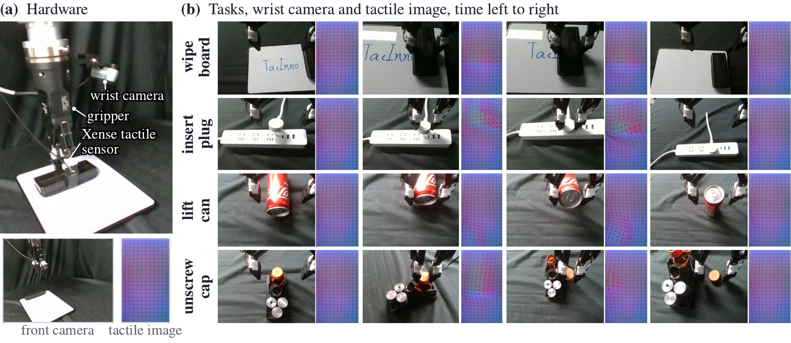

# Real-robot deployment

<p align="center"></p>

## Hardware and data

| Item | Setup in the paper |
|:--|:--|
| Robot | Franka FR3 with a parallel gripper |
| Tactile sensor | one Xense vision-based tactile sensor on a fingertip of the gripper |
| Cameras | a third-person camera and a wrist camera (640 × 480) |
| Teleoperation | GELLO at 30 Hz, 50 demonstrations per task; the first 45 train the tokenizer and the policy |
| Tasks | Wipe Board, Insert Plug, Lift Can (a lying can is stood upright), Unscrew Cap |
| Policy rate | 10 Hz, one action chunk of 32 steps per inference |

A trial counts as successful when the writing is wiped off the board, the plug is fully inserted, the can stands
upright, or the cap is separated from the bottle.

## Tactile observation

From the depth and marker estimates of the Xense sensor we compute the same tactile observation as in simulation, an
indentation depth map and a marker displacement field:

* **indentation**: the estimated depth minus the depth of the first frame of the episode (clipped at 0), resampled to
  96 × 128;
* **markers**: the reference and current positions of the 63 tracked markers, with a validity mask.

With a single sensor, the reading of the instrumented finger is used for both gels of the model, as in training. The
same processing is applied when the demonstrations are converted to training data
([data_preparation.md](data_preparation.md)), so deployment and training see identical inputs.

## Policy server

One server process loads the real-world checkpoint once and serves the four tasks:

```bash
python tools/serve_policy.py checkpoints/real/four_tasks --real-robot --bind 0.0.0.0 \
    --task real_wipe_board:8001 --task real_insert_plug:8002 --task real_lift_can:8003 --task real_unscrew_cap:8004
```

Each task gets its own port; the instruction of the task is set by the server. The joint and tactile statistics of
the released real-world model are bundled in `tacinno/datasets/stats/` and used by default.

The wire format is the msgpack/websocket protocol of the simulation server
([evaluation.md](evaluation.md#client-reference)). On connect the server sends its metadata (task, instruction,
action horizon, control rate, tactile history offsets). Each request holds one control step:

| Key | Value |
|:--|:--|
| `head`, `wrist` | uint8 RGB images of the third-person and wrist cameras, any size (resized to 224 × 224 by the server) |
| `qpos` | float32 (8,): the 7 arm joints in radians and the gripper opening |
| `tac_hist` | three tactile frames, of control steps t−8, t−4 and t (clipped at the start of the episode), each `w96` (96, 128) indentation, `mk` (2, 63, 2) reference and current marker positions, `valid` (63,) |
| `seed`, `k` | optional; seed the flow-matching noise for reproducible replays |

The reply holds `model8`, a (32, 8) chunk whose row i is the arm joint offset of step t+i and the gripper opening.

The gripper dimension is the normalized opening $n \in [0, 1]$ of the recordings multiplied by 0.045. Map it to the
command range of your gripper in the same way as the recordings were normalized.

## Execution on the robot

* **Chunked execution.** Execute rows 1 to 10 of each chunk at 10 Hz, then query again.
* **Resolve offsets against the last command.** Add the arm offsets to the joint target commanded at the inference
  step rather than to the measured joint state. A compliant joint controller lags its target, and resolving against
  the measured state shifts every new chunk in the direction of the lag, which accumulates over a trial.
* **Limit joint steps.** Clamp the per-step change of each joint target (we use 0.15 rad for joints 1 to 6 and 0.25 rad
  for joint 7) and interpolate the 10 Hz targets to the rate of the joint controller.
* **Match the recordings.** Feed images and tactile frames through the same compression and processing as the
  demonstrations, and use the camera poses of the recordings.

## Tactile-off test

Send the tactile frame of the first step of the trial (before contact) in all three slots of `tac_hist` at every
step, keeping all other inputs live.
